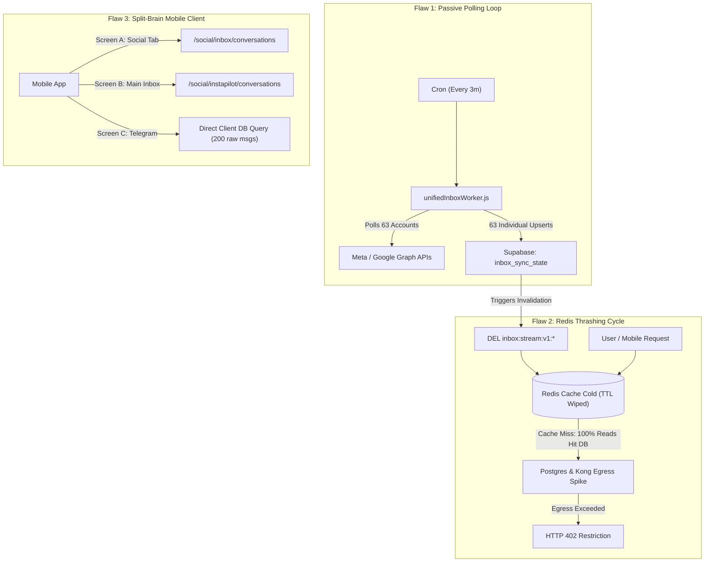
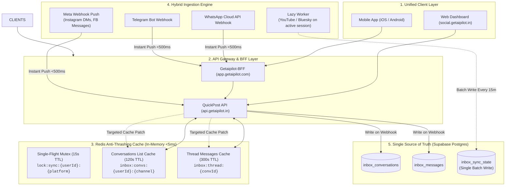
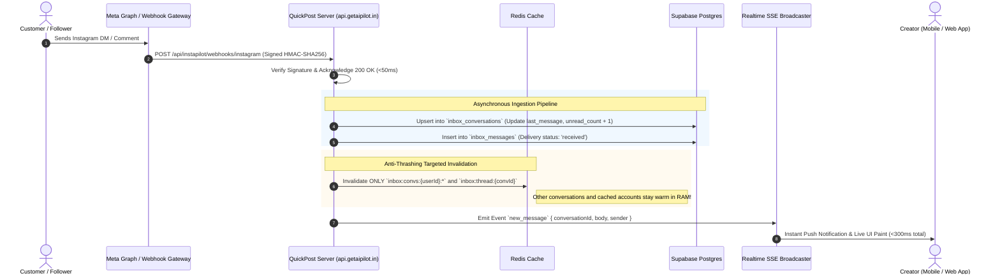
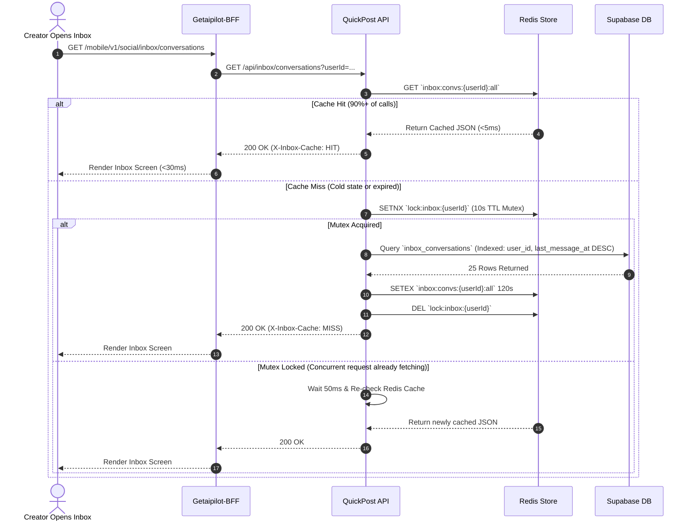

# High-Performance Chat & Social Inbox Architecture

This specification outlines the unified, production-ready chat architecture for **GetAiPilot** (Mobile App, BFF, and QuickPost Server). It details how to eliminate background database egress spikes, prevent Redis cache thrashing, and achieve sub-100ms message delivery.

---

## 1. The "Before" Architecture (The Root Cause of Failure)

Prior to optimization, the system suffered from **passive full-table polling**, **endpoint fragmentation**, and **cache thrashing**:



### Why Redis Thrashing Occurred:
1. **Unnecessary Invalidation**: `unifiedInboxWorker` ran every 3 minutes. Even when **zero new messages** arrived, it updated `last_attempt_at` in `inbox_sync_state` for all 63 accounts.
2. **Global Key Nuking**: Database changes triggered `invalidateInboxCache()`, destroying the entire user stream cache key (`inbox:stream:v1:*`).
3. **Cache Miss Storm**: Because cache was constantly wiped every 3 minutes, almost every incoming client request resulted in a cache miss, slamming Kong API Gateway and Postgres with raw queries.

---

## 2. The "After" Architecture (Event-Driven & Multi-Tier Redis Shielding)

The optimized architecture operates on three core principles:
1. **Webhooks-First**: 100% event-driven for platforms that support webhooks (Instagram, Facebook, WhatsApp, Telegram). Zero background polling.
2. **Lazy On-Demand Sync**: Passive platforms (YouTube comments, Bluesky) only sync when an authenticated user actively views the inbox.
3. **Targeted Redis Shielding**: Invalidate only the specific updated thread—never nuke the entire user inbox cache.



---

## 3. Inbound Webhook Execution Flow (Instant Delivery)

When a customer sends an Instagram DM, Facebook message, or WhatsApp text, it bypasses background cron workers completely:



---

## 4. User Inbox Read Flow with Single-Flight Redis Mutex

When the creator opens the inbox screen, the request is intercepted by Redis. If a cache miss occurs, a single-flight mutex ensures only **one** database query is run, preventing "dog-piling":



---

## 5. Redis Key Schema & TTL Policy

To prevent cache thrashing, use targeted namespaces with strict expiration policies:

| Cache Key | Type | TTL | Purpose | Invalidation Event |
| :--- | :--- | :--- | :--- | :--- |
| `inbox:convs:{userId}:{channel}` | `STRING` (JSON) | 120s | Stores top 50 conversation previews for the left sidebar. | Only on new inbound webhook or sent outbound reply. |
| `inbox:thread:{userId}:{convId}` | `STRING` (JSON) | 300s | Stores message history for the actively open chat. | Only when a new message arrives in that specific `convId`. |
| `inbox:sync_lock:{userId}:{platform}` | `STRING` (Mutex) | 15s | Single-flight lock preventing duplicate concurrent API calls. | Automatic TTL expiration. |
| `inbox:cooldown:{accountId}` | `STRING` | 1800s (30m) | Blocks syncing accounts that returned rate-limits or timeouts. | Automatic TTL expiration. |

---

## 6. Implementation Action Plan

### Step 1: Mobile App Endpoint Consolidation
* In [`getaipilot-app/src/features/inbox/api/inboxApi.ts`](file:///home/metabull/Projects/mobile/getaipilot-app/src/features/inbox/api/inboxApi.ts):
  * Replace the call to `/mobile/v1/social/instapilot/conversations` with `/mobile/v1/social/inbox/conversations`.
  * Point all Instagram, Facebook, and multi-channel UI components to the unified `inbox_conversations` contract.

### Step 2: Skip Webhook-Supported Platforms in Background Worker
* In [`QuickPost/server/src/workers/unifiedInboxWorker.js`](file:///home/metabull/Projects/QuickPost/server/src/workers/unifiedInboxWorker.js):
  * Exclude `instagram` and `facebook` from the recurring cron if their webhooks are active.
  * Only sync `youtube` and `bluesky`.

### Step 3: Implement Batch Writes in `unifiedInbox.js`
* In [`QuickPost/server/src/services/unifiedInbox.js`](file:///home/metabull/Projects/QuickPost/server/src/services/unifiedInbox.js):
  * Replace per-account `recordInboxSyncState` upserts with a single batched array upsert:
    ```javascript
    await supabase.from('inbox_sync_state').upsert(syncResultsBatch, {
      onConflict: 'user_id,platform,account_id'
    });
    ```

### Step 4: Add Redis Caching to `/inbox/conversations`
* Wrap `listInboxConversations` in [`inbox.js`](file:///home/metabull/Projects/QuickPost/server/src/routes/inbox.js) with the `inbox:convs:{userId}` Redis cache key with 120s TTL and single-flight mutex protection.
